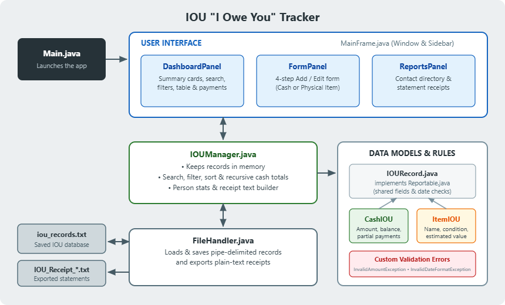

# IOU "I Owe You" Tracker

A desktop app built with Java Swing for keeping track of money and physical items you lend to others or borrow from them. Everything is saved automatically to a local text file (`iou_records.txt`).

---

## What It Can Do

### 1. Dashboard (Main Screen)
- **At-a-Glance Totals:** Three summary boxes at the top show:
  - **Owed to Me** (total cash and number of items others owe you)
  - **I Owe Others** (total cash and number of items you owe others)
  - **Net Balance** (whether you are overall positive, negative, or even on cash)
- **Live Search, Filters & Sorting:** Quickly search by name, reason, or item, filter by direction (*They Owe Me* / *I Owe Them*), category (*Cash Money* / *Borrowed Items*), or status (*Unsettled* / *Settled* / *Overdue*), and sort by due date, amount, or person's name.
- **Quick Record Actions:** Click any row in the table to:
  - **Record Payment / Return** (log full or partial cash payments, or mark a borrowed item as returned)
  - **Edit Record**
  - **Delete Record**
  - **View Statement** (jump straight to that person's report)

### 2. Add / Edit IOU Form
A 4-step form that lets you:
1. Choose whether someone owes you or you owe someone, and type a name or pick from existing contacts.
2. Choose **Cash Money** (amount in ₱) or **Physical Item** (item name, condition: *Brand New*, *Good*, or *Slightly Worn*, and estimated value).
3. Enter the creation date (`YYYY-MM-DD`), due date (`YYYY-MM-DD`), and reason/description.
4. Save with built-in input checks (highlights invalid fields and shows clear error pop-ups if a date, amount, or required field is wrong).

### 3. Reports
- **Contact Directory:** Lists every person you have records with, along with their net cash balance and active borrowed items.
- **Statement of Account:** Generates a clean, printable plain-text receipt showing active IOUs, past settled IOUs, and the final settlement amount.
- **Bulk Settle & Export:** Mark all active IOUs with a person as settled in one click, or export their receipt to a `.txt` file (`IOU_Receipt_<Name>.txt`).

---

## How It Works



---

## Project Structure

```text
IOUTrackerProject/
├── out/ioutracker/                         # Compiled .class files
├── src/ioutracker/                         
│   ├── Main.java                           # Starts the app and connects storage, logic, and UI
│   ├── MainFrame.java                      # Main window with left sidebar navigation & sync status bar
│   ├── DashboardPanel.java                 # Screen 1: Summary cards, search/filter toolbar, IOU table
│   ├── FormPanel.java                      # Screen 2: 4-step Add / Edit IOU form
│   ├── ReportsPanel.java                   # Screen 3: Contact directory & Statement of Account viewer
│   ├── IOUManager.java                     # Core logic (filtering, sorting, totals, stats, receipts)
│   ├── FileHandler.java                    # Reads/writes iou_records.txt and exports receipt .txt files
│   ├── IOURecord.java                      # Shared blueprint for all IOU records & date validation
│   ├── CashIOU.java                        # Cash record (tracks original amount & partial payments)
│   ├── ItemIOU.java                        # Physical item record (tracks name, condition, est. value)
│   ├── Reportable.java                     # Rules for how records display in the table and receipts
│   ├── InvalidAmountException.java         # Error thrown for invalid money/value entries
│   └── InvalidDateFormatException.java     # Error thrown when dates don't match YYYY-MM-DD
└── iou_records.txt                         # Local text file where all IOU records are stored
```

---

## How to Run

Make sure you have a Java Development Kit (JDK) installed, then run these commands from inside the **`IOUTrackerProject`** folder (so the app finds `iou_records.txt` in the right place):

1. **Compile the code:**
   ```bash
   javac -d out src/ioutracker/*.java
   ```

2. **Run the app:**
   ```bash
   java -cp out ioutracker.Main
   ```

*(If `iou_records.txt` doesn't exist yet, the app will automatically create an empty one on startup.)*

---

## How Data Is Saved

Records are saved in `iou_records.txt` with one record per line, separated by `|` symbols:

- **Cash IOU:**
  `Cash|id|direction|person|originalAmount|remainingBalance|dateCreated|dueDate|reason|status`
- **Item IOU:**
  `Item|id|direction|person|itemName|itemCondition|estimatedValue|dateCreated|dueDate|reason|status`